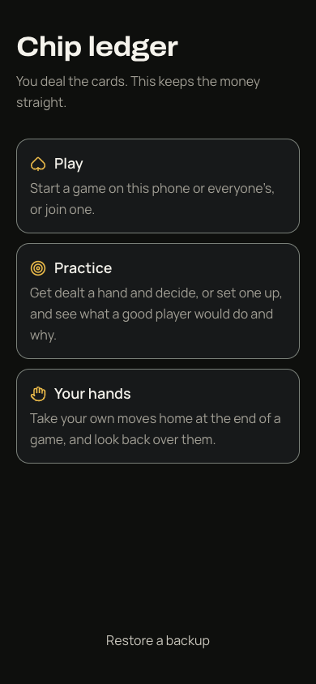
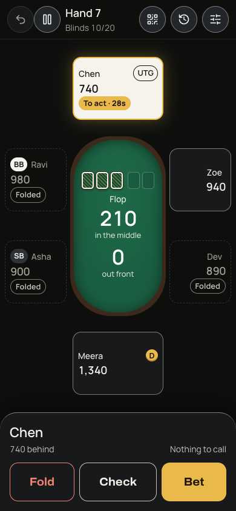
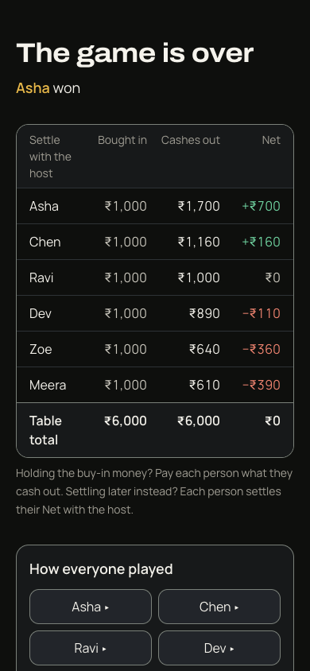

# Hi, I'm Vipin 👋

I make things that solve a real problem, and I don't call them done until they're proven to work.

## What I built: Chip Ledger

**[poker-ultimate.vercel.app](https://poker-ultimate.vercel.app)**

One evening my friends and I played cards with no chips. We did the maths in our heads and spent the night arguing about who owed what. So I built the app that would have settled it: a referee and ledger for a home game. You deal real cards, and it keeps the money straight.

It started as a quick prototype. **Nineteen days of building** turned it into an installable app at version 1.2.0.

  
  
  

**What's in it**

- **A rules engine written from scratch:** blinds that follow the table as people come and go, side pots, short all-ins, a turn clock and undo.
- **Multiplayer over a QR code:** every player can play from their own phone, while the host's phone stays the referee.
- **No accounts and no server holding anyone's data:** an installable app that works offline and keeps games in the phone's own storage, with backup and restore.
- **Practice mode:** play against the computer and get each decision graded.
- **"Know your game":** analysis of how each person played, worked out from the betting alone.

**How I built it**

- **2,634 automated checks**, with more test code than app code. A fix doesn't count until its test has been seen to fail without it.
- **Every push is proven live:** CI runs on two Node versions, the build is reproducible, and the live app is compared byte-for-byte with it.
- **152 issues worked through and 221 commits**, each change written up in plain words (67 notes so far).
- **A catalogue of my own mistakes,** grouped into twelve root causes, so the same kind of bug doesn't get fixed twice.
- **Built with AI coding agents.** I set the direction, make the product calls and set the rules that keep the work honest.

`TypeScript` · `React` · `Supabase Realtime` · `IndexedDB` · `esbuild` · `Node test runner` · `GitHub Actions` · `Vercel`

## Get in touch

📫 [LinkedIn](https://www.linkedin.com/in/vipin-kumar-k999/)
